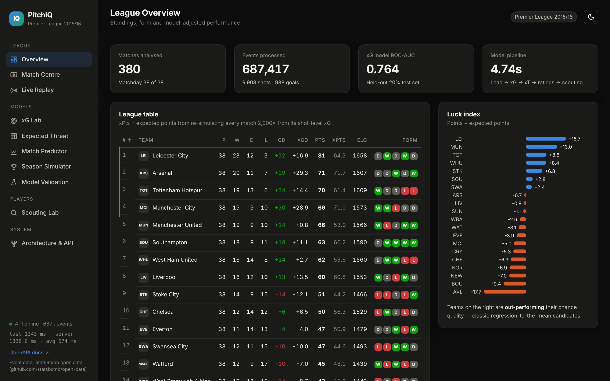
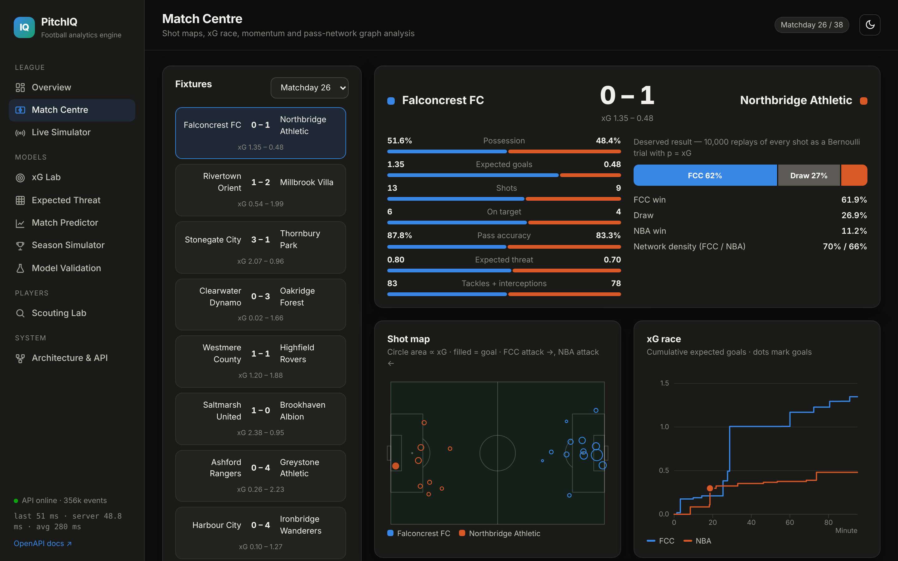
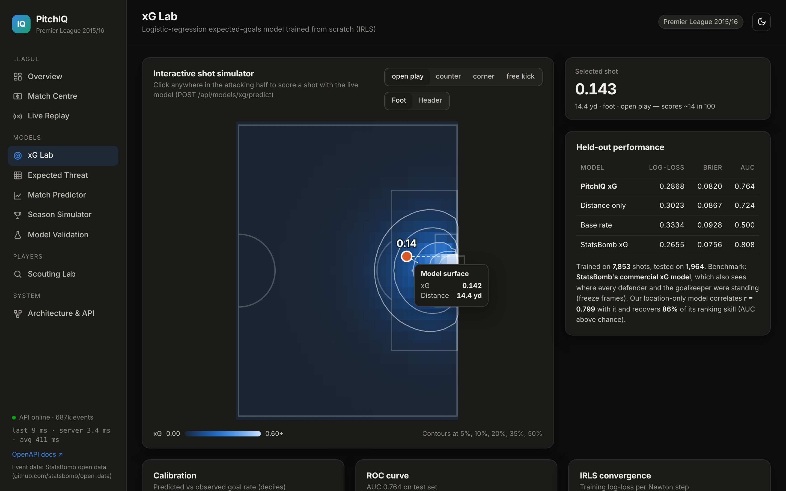
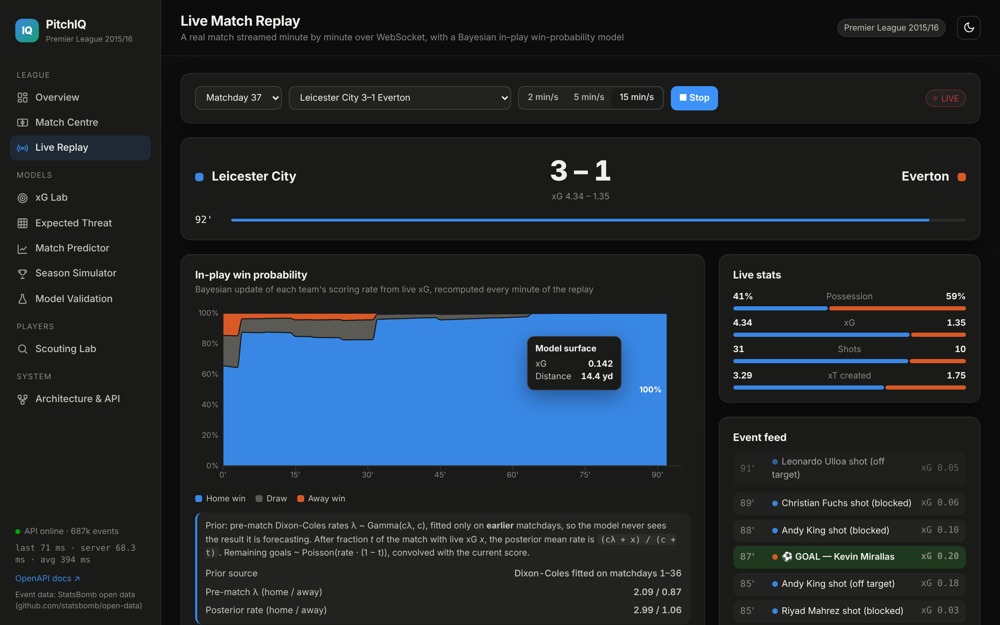
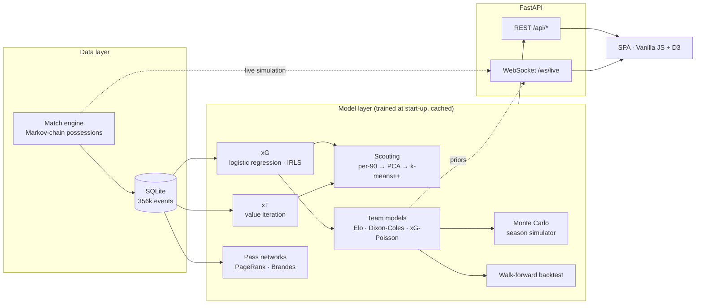

<div align="center">

# ⚽ PitchIQ: Football Analytics Engine

**Event-level football analytics, built from first principles in Python and JavaScript.**

Expected Goals · Expected Threat · Dixon-Coles · Elo · Monte Carlo · Pass-Network Graphs · PCA / k-means Scouting · Live WebSocket Win Probability




</div>

---

## What this is

PitchIQ is **not** a dashboard that pulls numbers from somebody else's API and draws them.
Every number on screen is computed by models implemented in this repository:

| Layer | What it does | Implemented with |
|---|---|---|
| **Match engine** | Simulates a 20-team league as ~356,000 StatsBomb-style events (passes, carries, shots, tackles, interceptions) using a Markov chain over pitch locations | Pure Python |
| **xG model** | Logistic regression trained with **Newton-Raphson / IRLS**, with standard errors, calibration, ROC and comparison against an oracle | NumPy (no scikit-learn) |
| **xT model** | 16×12 Markov-chain **Expected Threat** grid solved by **value iteration**; every pass and carry gets a value | NumPy |
| **Team ratings** | **Dixon-Coles** bivariate Poisson fitted by **maximum likelihood** with time decay and low-score correction, plus an xG-based variant and **Elo** | SciPy L-BFGS-B |
| **Forecasting** | **Vectorised Monte Carlo** of the remaining season (50,000 seasons in about 0.7 s) and a **walk-forward backtest** scored by the Ranked Probability Score | NumPy |
| **Graph analytics** | Per-match pass networks with **PageRank** (power iteration) and **betweenness centrality** (Brandes + Dijkstra) | Hand-written (no networkx) |
| **Scouting** | 14 per-90 features → **PCA via SVD** → **k-means++** with k chosen by **silhouette score** → **cosine-similarity** search | NumPy |
| **Live centre** | Streams a match over **WebSocket** with a **Bayesian (Gamma-Poisson) in-play win-probability model** | FastAPI + asyncio |
| **API** | 20 REST endpoints plus 1 WebSocket, OpenAPI docs, Pydantic validation, GZip, CORS, rate limiting, timing headers | FastAPI |
| **Frontend** | 10-view single-page app with a theme-aware design system, rendered entirely in D3 | Vanilla JS + D3 v7 |

### Why simulate the data?

Real event data is licensed, and it has **no ground truth**: you never know a shot's *true* probability or a team's *true* strength.
The engine knows both. That lets PitchIQ **prove** its models work, not just display their output:

- The xG model's test log-loss is **within 1.6% of the oracle**, the best score any model could reach. Its predictions correlate **r = 0.98** with the hidden true probabilities.
- xG-based team ratings recover hidden defensive strength with **r = 0.94**, against r = 0.85 for goal-based ratings. This is the core argument for using xG to rate teams.

The event schema mirrors StatsBomb's (120×80 pitch, attacking left to right, per-team perspective), so real open data can be fed into the same pipeline.

---

## Results (default seed, after matchday 26)

**xG model (held-out 20% of 5,547 shots)**

| Model | Log-loss ↓ | Brier ↓ | ROC-AUC ↑ |
|---|---|---|---|
| **PitchIQ xG (8 features, IRLS)** | **0.2780** | **0.0832** | **0.832** |
| Distance only | 0.2821 | 0.0845 | 0.816 |
| Base rate | 0.3524 | 0.1001 | 0.500 |
| *Oracle (true probabilities)* | *0.2736* | *0.0821* | *0.839* |

IRLS converges in **8 Newton steps**.

**Match forecasting (walk-forward backtest, 190 out-of-sample matches, no look-ahead)**

| Model | RPS ↓ | Log-loss ↓ | Accuracy |
|---|---|---|---|
| **Ensemble** | **0.1844** | **0.925** | 57.4% |
| xG-Poisson | 0.1850 | 0.926 | 57.4% |
| Dixon-Coles | 0.1876 | 0.971 | 58.4% |
| Elo | 0.2004 | 0.971 | 54.2% |
| Uniform (⅓ each) | 0.2392 | 1.099 | 35.3% |

**Ground-truth recovery (Pearson r against the hidden team strengths)**

| | Attack | Defence |
|---|---|---|
| Dixon-Coles on goals | 0.771 | 0.853 |
| Poisson on xG | **0.780** | **0.944** |

**Pipeline speed:** the full model stack (load 356k events → xG → xT → ratings → scouting) trains in **about 2.6 s** at start-up.

---

## Screenshots

| Match Centre | xG Lab |
|---|---|
|  |  |
| **Expected Threat** | **Live Simulator** |
|  |  |
| **Season Simulator** | **Model Validation** |
|  |  |
| **Scouting Lab** | **Match Predictor** |
|  |  |

---

## Architecture



### Request lifecycle
1. The browser loads `index.html`. The hash router lazy-imports one view module (`frontend/js/views/*.js`).
2. The view calls `api()`, a cached fetch wrapper that records round-trip and server latency (shown in the sidebar).
3. FastAPI middleware applies a per-IP sliding-window rate limit, runs the handler, and stamps `X-Process-Time-ms`.
4. Handlers read from the in-memory `Platform` object. Expensive results (season simulation, backtest, match detail) are memoised with `lru_cache`.
5. D3 renders every chart from CSS design tokens, so light and dark themes come for free.

---

## The models, briefly

<details>
<summary><b>Expected Goals (xG): logistic regression with IRLS</b></summary>

Features: distance, goal-mouth angle (the angle between the two posts as seen from the ball), distance × angle, log-distance, header, counter-attack, corner, direct free-kick.

$$p = \sigma(\beta^\top x), \qquad (X^\top W X + \lambda I)\,\Delta = X^\top (y-p) - \lambda\beta, \quad W=\mathrm{diag}(p(1-p))$$

Newton steps converge quadratically. The inverse Hessian at the optimum gives the standard errors, which the UI shows as Wald z-scores. Penalties use the empirical conversion rate.
Code: `backend/app/analytics/xg.py`
</details>

<details>
<summary><b>Expected Threat (xT): Markov chain plus value iteration</b></summary>

$$xT(z) = s(z)\,g(z) + m(z)\sum_{z'} T(z\to z')\,xT(z')$$

`s` = probability of shooting from zone z, `g` = probability that shot scores, `m` = probability of moving the ball, `T` = 192×192 transition matrix of successful moves.
The solver iterates from xT = 0 until max |Δ| < 1e-6 (47 iterations). Each action is credited with xT(end) − xT(start). The UI animates the iterations.
Code: `backend/app/analytics/xt.py`
</details>

<details>
<summary><b>Dixon-Coles: maximum-likelihood goals model</b></summary>

$$\log\lambda_{home} = \mu + h + a_i - d_j,\qquad \log\lambda_{away} = \mu + a_j - d_i$$

Fitted with L-BFGS-B. Identifiability comes from sum-to-zero constraints on attack and defence. Matches are weighted by exponential time decay $e^{-\xi\,\Delta t}$, and the τ(ρ) correction adjusts the 0-0, 1-0, 0-1 and 1-1 scorelines. The xG variant uses the same likelihood on expected goals.
Code: `backend/app/analytics/ratings.py`
</details>

<details>
<summary><b>Monte Carlo season simulation</b></summary>

For each remaining fixture, the full 11×11 scoreline matrix is sampled `n_sims` times in a single NumPy call. Points, goal difference and goals scored accumulate as `(n_sims × 20)` matrices and are ranked with one `argsort` that applies the official tie-breakers. The output is a 20×20 finishing-position probability matrix.
</details>

<details>
<summary><b>Live in-play win probability: Bayesian updating</b></summary>

Prior scoring rate λ ~ Gamma(cλ₀, c) from Dixon-Coles. After fraction *t* of the match with live xG *x*:

$$\mathbb{E}[\lambda \mid x] = \frac{c\lambda_0 + x}{c + t}$$

Remaining goals follow Poisson(E[λ]·(1−t)), convolved with the current score to give P(home), P(draw) and P(away). The server recomputes this every simulated minute and pushes it over the WebSocket.
Code: `backend/app/live.py`
</details>

<details>
<summary><b>Pass networks: PageRank and Brandes betweenness</b></summary>

Nodes are players, placed at their average touch location. Directed edges are completed passes. PageRank uses power iteration with damping 0.85. Betweenness uses Brandes' algorithm with Dijkstra, where edge length = 1 / pass count. Density and Freeman degree centralisation describe the team's shape.
Code: `backend/app/analytics/network.py`
</details>

<details>
<summary><b>Scouting: PCA, k-means++ and cosine similarity</b></summary>

14 per-90 features (goals, xG, xG/shot, passes, pass %, progressive passes, xT, box entries, carries, carry %, tackles, interceptions, average depth, ...) are z-scored.
PCA uses the SVD. k-means++ runs for k = 5…8 with 5 restarts each, and the k with the best silhouette score wins. Each cluster is named from its most distinctive trait relative to its positional group (e.g. *Goal-threat Striker*, *Metronome Midfielder*). The "similar players" list ranks by cosine similarity in standardised space.
Code: `backend/app/analytics/scouting.py`
</details>

---

## API

Interactive docs at **`/docs`** (Swagger) and **`/redoc`**.

| Method | Endpoint | Description |
|---|---|---|
| GET | `/api/health` | Liveness and pipeline timings |
| GET | `/api/overview` | KPIs, top scorers, over-performers |
| GET | `/api/league/table` | Standings with xG, xGD, xPts, Elo, form |
| GET | `/api/league/elo` | Elo history per team |
| GET | `/api/league/ratings` | Dixon-Coles ratings and ground-truth recovery |
| GET | `/api/teams/{id}` | Team dossier |
| GET | `/api/matches?matchday=&team_id=` | Fixtures (played, or upcoming with probabilities) |
| GET | `/api/matches/{id}` | Shots, xG race, momentum, both pass networks, "deserved" result |
| GET | `/api/models/xg` | Coefficients, SEs, calibration, ROC, convergence |
| POST | `/api/models/xg/predict` | Score up to 1,000 arbitrary shots |
| GET | `/api/models/xg/surface` | xG over a pitch grid |
| GET | `/api/models/xt` | xT grid, components, iteration snapshots, leaders |
| GET | `/api/predict?home=&away=` | Dixon-Coles / xG-Poisson / Elo / ensemble forecast and score matrix |
| GET | `/api/simulate/season?n=&model=&seed=` | Monte Carlo season simulation |
| GET | `/api/models/backtest` | Walk-forward RPS backtest |
| GET | `/api/players` · `/api/players/map` · `/api/players/{id}` · `/api/players/{id}/similar` | Player stats, scouting map, profile, similarity |
| WS | `/ws/live?home=&away=&speed=&seed=` | Minute-by-minute live match stream |

```bash
curl -X POST localhost:8000/api/models/xg/predict \
  -H 'Content-Type: application/json' \
  -d '[{"x":108,"y":40},{"x":100,"y":30,"header":true,"situation":"corner"}]'
```

---

## Quick start

```bash
git clone https://github.com/ashazzahmed10/football-analytics-dashboard.git && cd football-analytics-dashboard
```

```bash
pip install -r backend/requirements-dev.txt
```

```bash
cd backend && uvicorn app.main:app --port 8000
```

Open **http://localhost:8000**. The first start builds the SQLite event database (about 5 s). Later starts reuse it.

**Docker:**

```bash
docker build -t pitchiq . && docker run --rm -p 8000:8000 pitchiq
```

**Tests** (20 tests: model correctness, API contracts, WebSocket stream):

```bash
cd backend && python -m pytest -q
```

Useful `make` targets: `make install`, `make run`, `make test`, `make rebuild-data`, `make docker`.

---

## Project structure

```
pitchiq/
├── backend/
│   ├── app/
│   │   ├── main.py              # FastAPI app: routes, middleware, WebSocket, static hosting
│   │   ├── services.py          # Platform: loads events, trains & caches every model
│   │   ├── live.py              # WebSocket live match + Bayesian in-play model
│   │   ├── data/
│   │   │   ├── engine.py        # Markov-chain match simulator (event generator)
│   │   │   └── league.py        # League/squad generation, fixtures, SQLite persistence
│   │   └── analytics/
│   │       ├── xg.py            # Logistic regression (IRLS), AUC, calibration
│   │       ├── xt.py            # Expected Threat value iteration
│   │       ├── ratings.py       # Elo, Dixon-Coles MLE, Monte Carlo, RPS
│   │       ├── network.py       # PageRank, Brandes betweenness, pass networks
│   │       └── scouting.py      # PCA (SVD), k-means++, silhouette, similarity
│   └── tests/                   # pytest: models, API, WebSocket
├── frontend/
│   ├── index.html
│   ├── css/styles.css           # design tokens (light/dark), layout, components
│   ├── js/app.js                # hash router, theme, status
│   ├── js/api.js                # fetch cache + latency, WebSocket helper
│   ├── js/charts.js             # D3 primitives: pitch, line, bars, heatmaps, tooltips
│   └── js/views/                # one module per page
├── docs/screenshots/
├── Dockerfile · Makefile · .github/workflows/ci.yml
```

---

## 5-minute demo script (for judges)

1. **Overview**: "260 matches and 356k events, all modelled. The *Luck index* shows which teams' points outrun their chance quality."
2. **Match Centre**: open a match. Show the shot map, the xG race, and the "deserved result" (10,000 replays of the shots). Then the **pass network**: PageRank and betweenness, both hand-written.
3. **xG Lab**: click around the pitch to score shots live with a POST request. Show the calibration curve and the 8-iteration IRLS convergence, then point out *"within 1.6% of the theoretical optimum"*.
4. **Expected Threat**: press *Animate value iteration* and watch value spread backwards from the goal.
5. **Live Simulator**: kick off a match. Win probability updates every simulated minute over WebSockets, with the Bayesian update shown underneath.
6. **Season Simulator**: run 50,000 seasons (6 million simulated matches) in about 0.7 s.
7. **Model Validation**: the walk-forward backtest (no look-ahead) and ground-truth recovery. This is the page that shows the models are *right*, not just pretty.
8. **Architecture & API**: call any endpoint live and show the `/docs` OpenAPI page.

---

## Design decisions & trade-offs

- **From-scratch models:** IRLS, PCA, k-means, PageRank and Brandes are written in NumPy to show the maths. SciPy is used only as a general-purpose optimiser for the 41-parameter Dixon-Coles likelihood.
- **Train once, serve from memory:** the whole pipeline takes about 2.6 s, so it runs at start-up. Heavy, parameterised results are memoised.
- **No frontend build step:** ES modules plus a vendored D3 mean the app runs offline on a laptop at a demo table.
- **Accessible charts:** the categorical palette is checked for colour-vision deficiency, identity is never encoded by colour alone (legends, shapes, labels), and every chart has hover tooltips.

## Roadmap

- Adapter for StatsBomb open-data JSON → same event schema
- Possession-value model with gradient-boosted trees (VAEP-style)
- Player-tracking-free pitch-control approximation from event locations
- Persist model artefacts and add background re-training jobs

---

<sub>All teams and players are fictional and generated by the engine. Built with Python, FastAPI, NumPy, SciPy, pandas, SQLite, D3.js and vanilla JavaScript.</sub>
