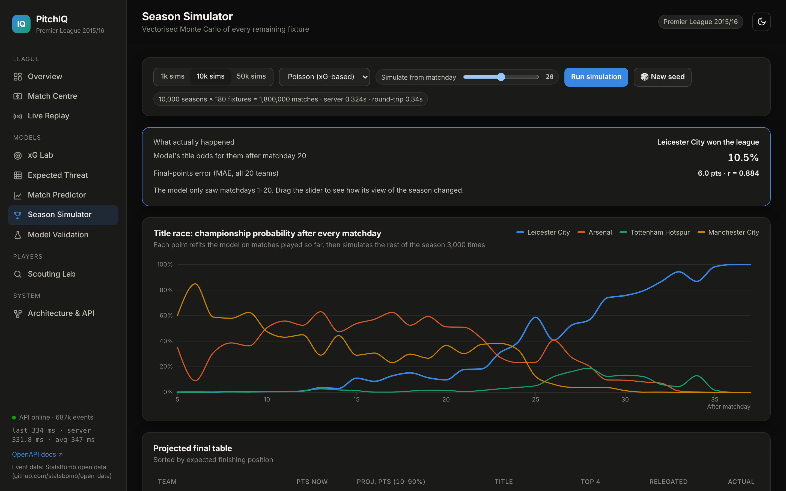
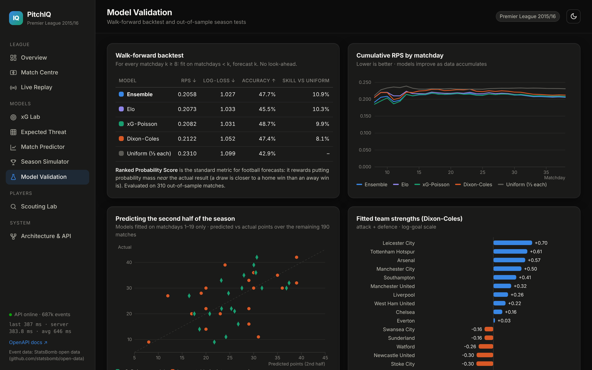
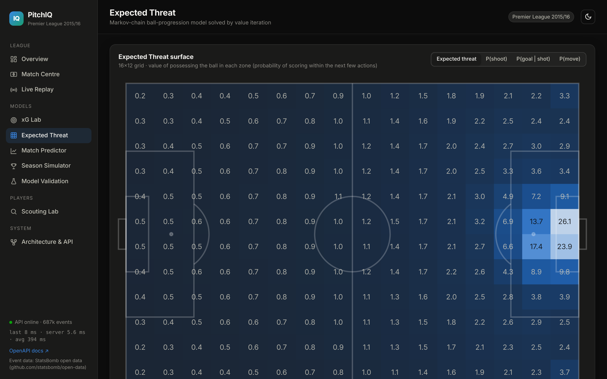
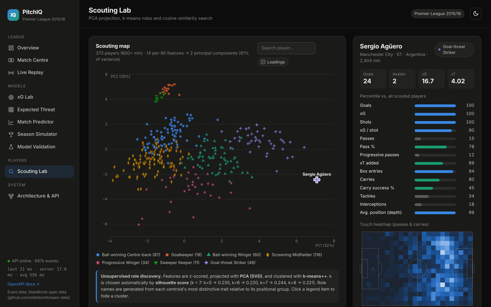
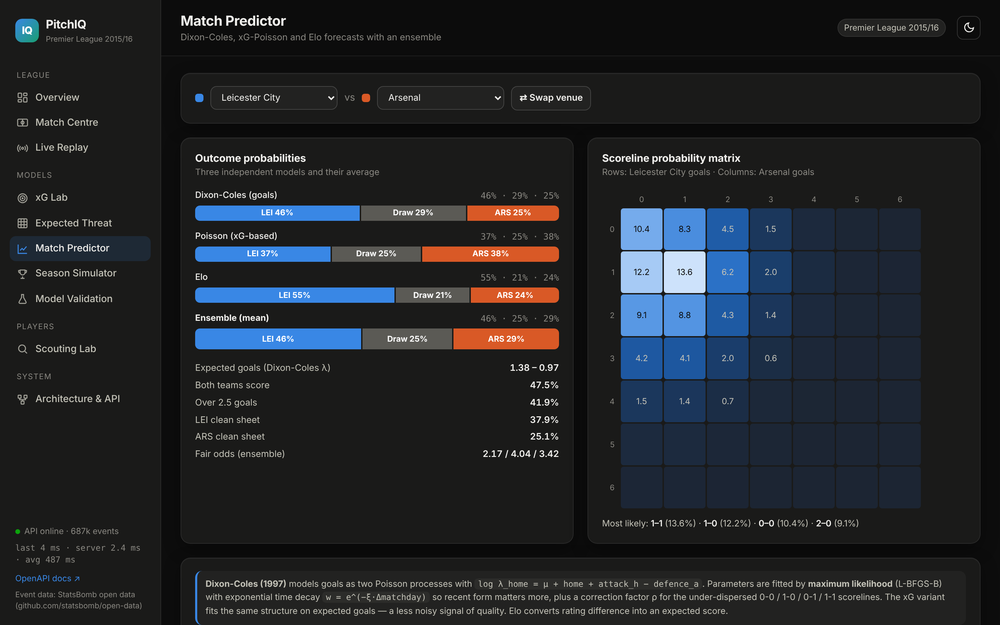
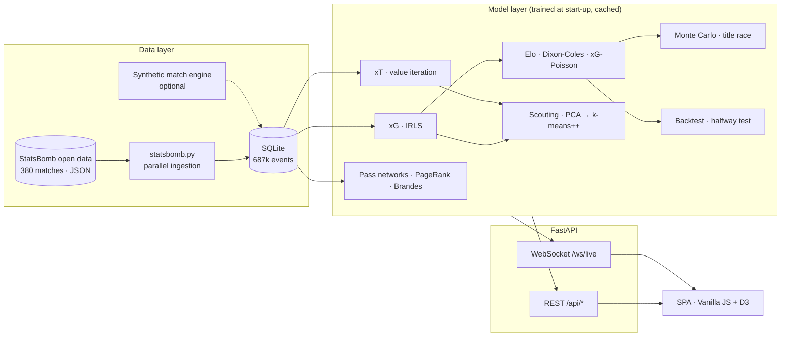

<div align="center">

# ⚽ PitchIQ: Football Analytics Engine

**Real Premier League event data, modelled from first principles in Python and JavaScript.**

Expected Goals · Expected Threat · Dixon-Coles · Elo · Monte Carlo · Pass-Network Graphs · PCA / k-means Scouting · Live WebSocket Win Probability


</div>

---

## What this is

PitchIQ analyses **every event of the 2015/16 Premier League season**: 380 matches, 549 real players and 687,417 passes, carries, dribbles, shots, tackles and interceptions. That was Leicester City's 5000-1 title season.

It is **not** a dashboard that pulls numbers from somebody else's API. The raw events come from [StatsBomb open data](https://github.com/statsbomb/open-data), and every metric on screen is computed by models implemented in this repository:

| Layer | What it does | Implemented with |
|---|---|---|
| **Ingestion** | Streams 380 match files + lineups from StatsBomb (8 parallel workers, ~35 s), maps them to one event schema, stores them in SQLite | Python stdlib |
| **xG model** | Logistic regression trained with **Newton-Raphson / IRLS**, with standard errors, calibration and ROC, **benchmarked against StatsBomb's commercial xG** | NumPy (no scikit-learn) |
| **xT model** | 16×12 Markov-chain **Expected Threat** grid solved by **value iteration**; every pass and carry gets a value | NumPy |
| **Team ratings** | **Dixon-Coles** bivariate Poisson fitted by **maximum likelihood** with time decay and low-score correction, an xG-based variant, and **Elo** | SciPy L-BFGS-B |
| **Forecasting** | **Vectorised Monte Carlo** season simulation from *any* matchday, a **title-race** chart, a **walk-forward backtest** (RPS) and a **second-half-of-season** test, all strictly out-of-sample | NumPy |
| **Graph analytics** | Per-match pass networks with **PageRank** (power iteration) and **betweenness centrality** (Brandes + Dijkstra) | Hand-written (no networkx) |
| **Scouting** | 14 per-90 features → **PCA via SVD** → **k-means++** with k chosen by **silhouette score** → **cosine-similarity** search | NumPy |
| **Live replay** | Streams a real match minute by minute over **WebSocket** with a **Bayesian (Gamma-Poisson) in-play win-probability model** | FastAPI + asyncio |
| **API** | 22 REST endpoints plus 1 WebSocket, OpenAPI docs, Pydantic validation, GZip, CORS, rate limiting, timing headers | FastAPI |
| **Frontend** | 10-view single-page app with a theme-aware design system, rendered entirely in D3 | Vanilla JS + D3 v7 |

### The headline result: could a model have seen Leicester coming?

The Season Simulator refits the model using **only matches played so far**, then simulates the rest of the season 10,000 times. Leicester's title probability from the xG-based model:

| After matchday | 10 | 19 (halfway) | 25 | 30 |
|---|---|---|---|---|
| **P(Leicester win the league)** | 0.6% | 10.7% | 57.8% | 76.2% |

The **title-race chart** plots this for every matchday. Arsenal and Manchester City dominate until February, then Leicester's line takes over.

---

## Results (all out-of-sample)

**xG model (held-out 20% of 9,908 real shots)**

| Model | Log-loss ↓ | Brier ↓ | ROC-AUC ↑ |
|---|---|---|---|
| **PitchIQ xG (8 features, IRLS)** | **0.2868** | **0.0820** | **0.764** |
| Distance only | 0.3023 | 0.0867 | 0.724 |
| Base rate | 0.3334 | 0.0928 | 0.500 |
| *StatsBomb xG (commercial benchmark)* | *0.2655* | *0.0756* | *0.808* |

StatsBomb's model also sees where every defender and the goalkeeper were standing (freeze frames). PitchIQ uses only shot location and context, yet recovers **86% of its ranking skill** (AUC above chance) and correlates **r = 0.80** with it. IRLS converges in **8 Newton steps**.

**Match forecasting (walk-forward backtest, 310 matches, each predicted using only earlier matchdays)**

| Model | RPS ↓ | Log-loss ↓ | Accuracy |
|---|---|---|---|
| **Ensemble** | **0.2058** | **1.027** | 47.7% |
| Elo | 0.2073 | 1.033 | 45.5% |
| xG-Poisson | 0.2082 | 1.031 | 48.7% |
| Dixon-Coles | 0.2122 | 1.052 | 47.4% |
| Uniform (⅓ each) | 0.2310 | 1.099 | 42.9% |

**Predicting the second half of the season (fit on matchdays 1–19, predict each team's points in matchdays 20–38)**

| Method | Mean abs. error ↓ | Correlation ↑ |
|---|---|---|
| **xG-Poisson ratings** | **6.36 pts** | **0.568** |
| League table (points per game × games left) | 6.75 pts | 0.510 |
| Dixon-Coles (goals) | 6.96 pts | 0.503 |

xG beats the table. It measures the chances teams create and concede, which is more stable than results.

---

## Screenshots

| Match Centre | xG Lab |
|---|---|
|  |  |
| **Season Simulator & Title Race** | **Model Validation** |
|  |  |
| **Live Replay** | **Expected Threat** |
|  |  |
| **Scouting Lab** | **Match Predictor** |
|  |  |

---

## Architecture



### Request lifecycle
1. The browser loads `index.html`. The hash router lazy-imports one view module (`frontend/js/views/*.js`).
2. The view calls `api()`, a cached fetch wrapper that records round-trip and server latency (shown in the sidebar).
3. FastAPI middleware applies a per-IP sliding-window rate limit, runs the handler, and stamps `X-Process-Time-ms`.
4. Handlers read from the in-memory `Platform` object. Expensive results (season simulations, title race, backtest, match detail) are memoised with `lru_cache`.
5. D3 renders every chart from CSS design tokens, so light and dark themes come for free.

---

## The models, briefly

<details>
<summary><b>Expected Goals (xG): logistic regression with IRLS</b></summary>

Features: distance, goal-mouth angle (the angle between the posts as seen from the ball), distance × angle, log-distance, header, counter-attack, corner, direct free-kick.

$$p = \sigma(\beta^\top x), \qquad (X^\top W X + \lambda I)\,\Delta = X^\top (y-p) - \lambda\beta, \quad W=\mathrm{diag}(p(1-p))$$

Newton steps converge quadratically. The inverse Hessian at the optimum gives standard errors, which the UI shows as Wald z-scores. Penalties use the empirical conversion rate (81%).
Code: `backend/app/analytics/xg.py`
</details>

<details>
<summary><b>Expected Threat (xT): Markov chain plus value iteration</b></summary>

$$xT(z) = s(z)\,g(z) + m(z)\sum_{z'} T(z\to z')\,xT(z')$$

`s` = probability of shooting from zone z, `g` = probability that shot scores, `m` = probability of moving the ball, `T` = 192×192 transition matrix estimated from 645k passes and carries. The solver iterates from xT = 0 until max |Δ| < 1e-6, and the UI animates the iterations. Each action is credited with xT(end) − xT(start).
Code: `backend/app/analytics/xt.py`
</details>

<details>
<summary><b>Dixon-Coles: maximum-likelihood goals model</b></summary>

$$\log\lambda_{home} = \mu + h + a_i - d_j,\qquad \log\lambda_{away} = \mu + a_j - d_i$$

Fitted with L-BFGS-B. Identifiability comes from sum-to-zero constraints on attack and defence. Matches are weighted by exponential time decay $e^{-\xi\,\Delta t}$, and the τ(ρ) correction adjusts the 0-0, 1-0, 0-1 and 1-1 scorelines. The xG variant uses the same likelihood on expected goals.
Code: `backend/app/analytics/ratings.py`
</details>

<details>
<summary><b>Monte Carlo season simulation and title race</b></summary>

Given a cut-off matchday *k*, models are refitted on matchdays ≤ k. Every later fixture's 11×11 scoreline matrix is then sampled `n_sims` times in one NumPy call. Points, goal difference and goals scored accumulate as `(n_sims × 20)` matrices and are ranked with a single `argsort` that applies the official tie-breakers. The title race repeats this for every k from 5 to 37.
</details>

<details>
<summary><b>Live replay: Bayesian in-play win probability</b></summary>

Pre-match rates come from Dixon-Coles fitted only on earlier matchdays. The prior is λ ~ Gamma(cλ₀, c). After fraction *t* of the match with live xG *x*:

$$\mathbb{E}[\lambda \mid x] = \frac{c\lambda_0 + x}{c + t}$$

Remaining goals follow Poisson(E[λ]·(1−t)), convolved with the current score to give P(home), P(draw) and P(away). The server pushes this over the WebSocket every minute of the replay.
Code: `backend/app/live.py`
</details>

<details>
<summary><b>Pass networks: PageRank and Brandes betweenness</b></summary>

Nodes are players, placed at their average touch location. Directed edges are completed passes. PageRank uses power iteration with damping 0.85. Betweenness uses Brandes' algorithm with Dijkstra, where edge length = 1 / pass count. Density and Freeman degree centralisation describe the team's shape.
Code: `backend/app/analytics/network.py`
</details>

<details>
<summary><b>Scouting: PCA, k-means++ and cosine similarity</b></summary>

14 per-90 features (goals, xG, xG/shot, passes, pass %, progressive passes, xT, box entries, carries, dribble %, tackles, interceptions, average depth, ...) are z-scored for the 373 players with 600+ minutes. PCA uses the SVD. k-means++ runs for k = 5…8 and the k with the best silhouette score wins. Cluster names come from each centroid's most distinctive trait (e.g. *Goal-threat Striker*, *Screening Midfielder*, *Sweeper Keeper*). Agüero's nearest neighbours by cosine similarity are Kane, Sturridge, Mané and Vardy.
Code: `backend/app/analytics/scouting.py`
</details>

---

## API

Interactive docs at **`/docs`** (Swagger) and **`/redoc`**.

| Method | Endpoint | Description |
|---|---|---|
| GET | `/api/health` | Liveness and pipeline timings |
| GET | `/api/overview` | KPIs, top scorers, over-performers, data source |
| GET | `/api/league/table` | Standings with xG, xGD, xPts, Elo, form |
| GET | `/api/league/elo` | Elo history per team |
| GET | `/api/league/ratings` | Dixon-Coles ratings |
| GET | `/api/teams` · `/api/teams/{id}` | Teams and team dossier |
| GET | `/api/matches?matchday=&team_id=` | Fixtures |
| GET | `/api/matches/{id}` | Shots, xG race, momentum, both pass networks, "deserved" result |
| GET | `/api/models/xg` | Coefficients, SEs, calibration, ROC, convergence, benchmark |
| POST | `/api/models/xg/predict` | Score up to 1,000 arbitrary shots |
| GET | `/api/models/xg/surface` | xG over a pitch grid |
| GET | `/api/models/xt` | xT grid, components, iteration snapshots, leaders |
| GET | `/api/predict?home=&away=` | Dixon-Coles / xG-Poisson / Elo / ensemble forecast and score matrix |
| GET | `/api/simulate/season?n=&model=&as_of=` | Monte Carlo from any matchday, with the actual outcome |
| GET | `/api/simulate/title-race` | Title / top-4 / relegation odds after every matchday |
| GET | `/api/models/backtest` | Walk-forward RPS backtest |
| GET | `/api/models/halfway` | Second-half-of-season prediction test |
| GET | `/api/players` · `/api/players/map` · `/api/players/{id}` · `/api/players/{id}/similar` | Player stats, scouting map, profile, similarity |
| WS | `/ws/live?match_id=&speed=` | Minute-by-minute match replay |

```bash
curl -X POST localhost:8000/api/models/xg/predict \
  -H 'Content-Type: application/json' \
  -d '[{"x":108,"y":40},{"x":100,"y":30,"header":true,"situation":"corner"}]'
```

---

## Quick start

```bash
git clone https://github.com/ashazzahmed10/football-analytics-dashboard.git && cd football-analytics-dashboard
```

```bash
python3 -m venv .venv && source .venv/bin/activate
```

```bash
python -m pip install -r backend/requirements-dev.txt
```

```bash
cd backend && python -m uvicorn app.main:app --port 8000
```

Open **http://localhost:8000**. The Premier League database ships compressed in `backend/data/statsbomb.db.gz` (17 MB) and unpacks automatically on first start, so **no internet is needed at a demo table**.

| Option | Command |
|---|---|
| Re-download the season from StatsBomb | `cd backend && python -m app.data.statsbomb --gzip` |
| Another league (La Liga / Serie A / Ligue 1 2015/16) | `python -m app.data.statsbomb --competition 11 --season 27 --out data/statsbomb.db` |
| Synthetic league with known ground truth (to prove the estimators are unbiased) | `PITCHIQ_SOURCE=synthetic python -m uvicorn app.main:app` |
| Docker | `docker build -t pitchiq . && docker run --rm -p 8000:8000 pitchiq` |

**Tests** (25 tests: model correctness, StatsBomb parser, API contracts, WebSocket stream; they run offline on a small synthetic league):

```bash
cd backend && python -m pytest -q
```

---

## Project structure

```
backend/
├── app/
│   ├── main.py              # FastAPI app: routes, middleware, WebSocket, static hosting
│   ├── services.py          # Platform: loads events, trains & caches every model
│   ├── live.py              # WebSocket match replay + Bayesian in-play model
│   ├── data/
│   │   ├── statsbomb.py     # StatsBomb open-data ingestion (parallel, streaming)
│   │   ├── engine.py        # Synthetic Markov-chain match simulator (ground-truth mode)
│   │   └── league.py        # Shared SQLite schema, synthetic league generation
│   └── analytics/
│       ├── xg.py            # Logistic regression (IRLS), AUC, calibration
│       ├── xt.py            # Expected Threat value iteration
│       ├── ratings.py       # Elo, Dixon-Coles MLE, Monte Carlo, RPS
│       ├── network.py       # PageRank, Brandes betweenness, pass networks
│       └── scouting.py      # PCA (SVD), k-means++, silhouette, similarity
├── data/statsbomb.db.gz     # Premier League 2015/16, preprocessed
└── tests/
frontend/
├── index.html · css/styles.css
└── js/  app.js (router) · api.js · charts.js (D3 primitives) · views/*.js (one per page)
```

---

## 5-minute demo script (for judges)

1. **Overview**: the real 2015/16 table. The *Luck index* shows Leicester **+16.7 points above their expected points**, the biggest over-performance in the league.
2. **Season Simulator**: drag *Simulate from matchday* from 10 to 30 and watch Leicester's title odds go from 0.6% to 76%. Then show the **title-race chart**. Every point uses only past matches.
3. **Match Centre**: open any match. Show the shot map, the xG race, the "deserved result" (10,000 replays of the shots), and the **pass network** with hand-written PageRank and betweenness.
4. **xG Lab**: click around the pitch to score shots live, then compare against **StatsBomb's professional model**.
5. **Live Replay**: replay Leicester 3–1 Everton (trophy day) or any match. Win probability updates every minute over WebSockets.
6. **Model Validation**: the walk-forward backtest and the second-half test, where *xG beats the league table*.
7. **Scouting Lab**: search Kanté or Vardy and see their role cluster and most similar players.
8. **Architecture & API**: call any endpoint live and show the `/docs` OpenAPI page.

---

## Design decisions & trade-offs

- **From-scratch models:** IRLS, PCA, k-means, PageRank and Brandes are written in NumPy to show the maths. SciPy is used only as a general-purpose optimiser for the 41-parameter Dixon-Coles likelihood.
- **Honest evaluation:** every forecast is fitted only on matches before the ones it predicts. The live replay's prior is fitted on earlier matchdays only.
- **Two data modes:** real data for credibility, plus a synthetic league whose hidden parameters are known, to verify that the estimators recover the truth.
- **Train once, serve from memory:** the full model pipeline takes about 5 s at start-up. Heavy, parameterised results are memoised.
- **No frontend build step:** ES modules plus a vendored D3 mean the app runs offline on a laptop.
- **Accessible charts:** the categorical palette is checked for colour-vision deficiency, identity is never encoded by colour alone, and every chart has hover tooltips.

## Data & attribution

Event data: **[StatsBomb open data](https://github.com/statsbomb/open-data)**, free for non-commercial use with attribution to StatsBomb. Own goals are not recorded as shots, so goal totals from shots (988) differ slightly from the official table (1,026); the league table uses the official scores.

## Roadmap

- Use StatsBomb freeze frames (defender positions) as xG features, to close the gap to the commercial model
- Possession-value model with gradient-boosted trees (VAEP-style)
- Multi-season support with player tracking across seasons
